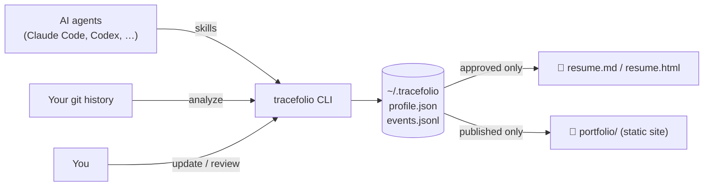

<div align="center">


# Tracefolio

### Your work, continuously understood.

**Turn the real work you ship, with or without AI, into an evidence-backed resume and a beautiful portfolio.**<br>
Local-first. Works with Claude Code and Codex. Never invents a single claim.

[](https://github.com/Kutluhankurt/tracefolio/actions/workflows/ci.yml)
[](https://github.com/Kutluhankurt/tracefolio/releases)
[](LICENSE)
[](https://nodejs.org)
[](https://www.typescriptlang.org)
[](CONTRIBUTING.md)

**[🌐 Live demo](https://kutluhankurt.github.io/tracefolio/)** · [📄 Demo resume](https://kutluhankurt.github.io/tracefolio/resume.html) · [Quick start](#-quick-start) · [How it works](#-how-it-works) · [AI integrations](#-ai-integrations) · [Privacy](#-privacy-by-default) · [Roadmap](#-roadmap)

<br>

<picture>
  <source media="(prefers-color-scheme: dark)" srcset="docs/portfolio-dark.png">
  
</picture>

<sub>Generated from the fictional <a href="examples/demo">demo profile</a> with one command. <a href="https://kutluhankurt.github.io/tracefolio/"><b>See it live →</b></a></sub>

</div>

---

## 🤔 Why Tracefolio?

You ship features, fix gnarly bugs and run migrations every week, often pairing with an AI assistant. Then a recruiter asks for your CV and **none of it is there**.

|  | Typical CV builder | AI "write my resume" prompt | **Tracefolio** |
| --- | :-: | :-: | :-: |
| Built from your actual commits | ❌ | ❌ | ✅ |
| Every claim linked to evidence | ❌ | ❌ | ✅ |
| Refuses to invent metrics | – | ❌ | ✅ |
| Your data stays on your machine | ❌ | ❌ | ✅ |
| Works with any AI tool, or none | – | ❌ | ✅ |
| Resume **and** portfolio site | ⚠️ | ❌ | ✅ |
| Free and open source (MIT) | ⚠️ | ⚠️ | ✅ |

## ✨ Features

<table>
<tr>
<td width="50%" valign="top">

### 🔍 Evidence collection
Scans your git history and keeps **only your commits**, grouped into readable draft events. Skills are inferred from the files you touched. Re-running never creates duplicates.

</td>
<td width="50%" valign="top">

### ✅ You stay in control
Every record starts as a **draft**. You approve it for the resume, verify it against evidence, publish it to your portfolio, or reject it. Nothing skips that step.

</td>
</tr>
<tr>
<td valign="top">

### 🚫 No fabrication
"Cut latency by 80%" only appears if **you** marked that metric as verified against evidence. Unverified numbers are never rendered, anywhere.

</td>
<td valign="top">

### 🔒 Private by default
Plain JSON files on your disk and zero network calls. `.env` files, keys and secrets are filtered out, tokens in commit messages are redacted, and private repos never leak commit hashes.

</td>
</tr>
<tr>
<td valign="top">

### 📄 ATS-friendly resume
A clean Markdown resume plus a print-ready HTML version (save it as PDF from your browser). Built-in checks warn you about common ATS problems.

</td>
<td valign="top">

### 🎨 A portfolio worth sharing
An editorial static site with light and dark themes, scroll reveals and project story pages. It respects `prefers-reduced-motion` and works without JavaScript.

</td>
</tr>
<tr>
<td valign="top">

### 🤖 AI-native, not AI-locked
Ready-made skills for **Claude Code** and **Codex** let your agent capture work right after it's done. Any other tool can integrate through one CLI command.

</td>
<td valign="top">

### 📦 Portable and versioned
Your career memory is a git repo of JSON/JSONL files. Diff it, back it up, move it anywhere, or build your own theme from `portfolio.json`.

</td>
</tr>
</table>

## 🚀 Quick start

> Requires **Node.js 20+**, **git** and **[pnpm](https://pnpm.io) 9**.

```bash
git clone https://github.com/Kutluhankurt/tracefolio.git
cd tracefolio
pnpm install && pnpm build
cd packages/cli && npm link && cd ../..   # adds `tracefolio` to PATH
```

Then, in about a minute:

```bash
# 1. Create your profile (in ~/.tracefolio)
tracefolio init --headline "Backend engineer"

# 2. Draft career events from your commits
tracefolio analyze ~/code/my-project --since "6 months ago"

# 3. Approve, verify, publish or reject each draft
tracefolio review

# 4. Generate resume.md, resume.html and portfolio/
tracefolio build

# 5. Preview the portfolio at http://127.0.0.1:4321
tracefolio portfolio dev
```

This is what it looks like on a real repository:

```console
$ tracefolio analyze .
repo: 4 commits scanned, 3 yours, 0 already recorded, 1 skipped as sensitive → 1 draft event(s)
  added project "repo" to profile.json (private until you change it)
Saved 1 draft(s). Review them with `tracefolio review`.

$ tracefolio review --list
evt_mv9kmaju0dc09eb2  [draft]  repo: 2 commits (week of 2026-10-12)
  project: repo · source: git · evidence: 2 commits
  skills: Docker, Python, TypeScript
  - Add API client
  - Add worker and container token=[REDACTED]
```

Just want to look around? Build the fictional demo profile, no setup needed:

```bash
pnpm tracefolio --home examples/demo build --out /tmp/tracefolio-demo
```

## 🧭 How it works



### Record lifecycle

| Status | Meaning | In resume | In portfolio |
| --- | --- | :-: | :-: |
| `draft` | Proposed by `analyze`, an agent, or you | – | – |
| `reviewed` | You approved it | ✅ | – |
| `verified` | Approved **and** backed by evidence you checked | ✅ | – |
| `published` | You chose to show it publicly | ✅ | ✅ |
| `rejected` | Hidden forever; its commits are never re-imported | – | – |

> Approving a record does not verify its claims. Impact metrics have their own `verified` flag, and verifying one requires evidence.

### Where your data lives

| Path (inside `~/.tracefolio`) | What it is |
| --- | --- |
| `profile/profile.json` | You: name, links, experience, education, projects, project stories. Edit by hand. |
| `profile/events.jsonl` | Career events, one per line. Managed through the CLI. |
| `tracefolio.config.json` | Grouping and privacy settings. |
| `out/` | Generated resume and portfolio (git-ignored). |

The location is taken from `--home`, then `$TRACEFOLIO_HOME`, then the nearest parent folder containing `tracefolio.config.json`, then `~/.tracefolio`.

## 🤖 AI integrations

```bash
tracefolio integrate claude-code          # → .claude/skills/tracefolio-*/SKILL.md
tracefolio integrate claude-code --user   # → ~/.claude/skills/
tracefolio integrate codex                # → AGENTS.md (marked block, updated in place)
tracefolio integrate codex --user         # → ~/.codex/AGENTS.md
```

After that, just tell your agent *"capture this work in Tracefolio"*. Three skills ship in [`skills/`](skills):

| Skill | What the agent does |
| --- | --- |
| **capture-work** | Records the work from the current session as a draft, with its commits as evidence |
| **update-career** | Runs `analyze`, then walks you through reviewing drafts |
| **generate-portfolio** | Builds the resume and portfolio, and helps write project stories |

The skills tell agents to **create drafts only, never invent metrics, keep secrets and customer details out, and ask before recording anything**. Any other tool can integrate with `tracefolio update --json -`.

<details>
<summary><b>Example: what your agent runs</b></summary>

```bash
tracefolio update \
  --title "Add retry with backoff to the device updater" \
  --summary "Replaced fixed retries with exponential backoff so flaky field links stop exhausting the queue." \
  --skills "Python,Networking,Reliability" \
  --repo . --commit 3f2a9c1 --commit 8be41d0 \
  --source claude-code
```

</details>

> **Honest limitation:** Tracefolio only sees what you or your agents hand it. It cannot read your ChatGPT web conversations, and each tool offers different integration hooks.

## 📚 Command reference

<details>
<summary><b>All commands and options</b></summary>

| Command | Purpose |
| --- | --- |
| `tracefolio init` | Create the profile. `--name`, `--email`, `--headline`, `--git-email` (repeatable), `--no-git`, `--force` |
| `tracefolio analyze [repos...]` | Turn your new commits into drafts. `--author`, `--since`, `--until`, `--group-by commit\|day\|week`, `--dry-run` |
| `tracefolio update` | Record a draft. `--title`, `--summary`, `--skills a,b`, `--project`, `--commit` + `--repo`, `--url`, `--file`, `--note`, `--metric`, `--source`, `--json <file\|->` |
| `tracefolio review` | Interactive review. `--list [--filter status] [--json]`; `review <id> --status … --title … --summary … --skills … --metric … --impact-verified` |
| `tracefolio build` | `--format markdown\|html\|json\|portfolio\|all` (default `all`), `--out <dir>` |
| `tracefolio portfolio build\|dev` | Build the static site, or build and serve it on localhost (`--port`) |
| `tracefolio project add <id>\|list` | `--name`, `--description`, `--url`, `--repository`, `--public`/`--private`, `--featured` |
| `tracefolio integrate claude-code\|codex` | Install agent skills: `--project <dir>` or `--user` |
| `tracefolio status` / `validate` | Counts per status; validate every file against the schema |

**Which commits are yours:** `--author`, otherwise `identities.gitEmails` in `profile.json`, otherwise the repository's `git config user.email`.

</details>

## 🎨 The portfolio

<p align="center">
  
</p>

- Project pages tell a story: **problem → your role → approach → implementation → outcome → evidence**. Write it under `projects[].story` in `profile.json`.
- Mark a project `--public` to show repository and commit links. Private projects only show "N commits in a private repository".
- `portfolio.json` holds exactly the data on the page, so you can build your own theme on top.
- Deploy `out/portfolio/` to GitHub Pages, Netlify or any static host when *you* decide to. Tracefolio never publishes anything by itself.

## 🔒 Privacy by default

- **Local only:** no network calls, no accounts, no telemetry.
- **Sensitive files are skipped:** `.env*`, `*.pem`, `*.key`, `id_rsa*`, `*secret*`, `*credentials*`, `secrets/**` and more. Their names, stats and inferred skills are never stored. Add your own patterns under `privacy.sensitivePatterns`.
- **Secrets are redacted:** GitHub, AWS, OpenAI and Slack tokens, JWTs, `password=…` values, and credentials embedded in remote URLs.
- **Commit messages are evidence, not proof.** Every claim goes through your review.

Found a security issue? Please report it privately; see [SECURITY.md](SECURITY.md).

## 🗺️ Roadmap

- [x] CLI, JSON/JSONL profile, schema validation
- [x] Git analysis with de-duplication, sensitive-file filters and secret redaction
- [x] Review workflow and separately verified impact metrics
- [x] Markdown and HTML resume with ATS checks
- [x] Static, animated portfolio with light and dark themes
- [x] Claude Code and Codex integrations
- [ ] Direct PDF export
- [ ] Multiple resume templates and tailoring to a job posting
- [ ] MCP server and more agent adapters
- [ ] Astro portfolio theme and a GitHub Pages deploy recipe
- [ ] Signed evidence bundles, multi-language output, career models beyond software

The full product plan (in Turkish) is in [TRACEFOLIO_PLAN.md](TRACEFOLIO_PLAN.md). Ideas and votes are welcome in [Issues](https://github.com/Kutluhankurt/tracefolio/issues).

## 🙋 FAQ

<details>
<summary><b>Do I need an AI tool to use Tracefolio?</b></summary>

No. `init`, `analyze`, `review` and `build` work entirely on their own. AI integrations are optional extras.
</details>

<details>
<summary><b>Will it upload my code anywhere?</b></summary>

No. Tracefolio makes no network calls. It stores commit metadata (hash, date, subject, line counts), never file contents.
</details>

<details>
<summary><b>I work on private company repos. Is that safe?</b></summary>

Projects are private by default. Private projects never show commit hashes or repository links on the portfolio, and nothing becomes public until you publish it. Still, review titles and summaries for customer names before you publish.
</details>

<details>
<summary><b>How do I get a PDF?</b></summary>

Run `tracefolio build --format html`, open `out/resume.html` in your browser and choose **Print → Save as PDF**. The page includes print styles. Direct PDF export is on the roadmap.
</details>

## 🤝 Contributing

Contributions of every size are welcome: bug reports, new skill mappings, themes and agent adapters. Read [CONTRIBUTING.md](CONTRIBUTING.md) to get started.

```bash
pnpm install && pnpm build && pnpm test
```

If Tracefolio helps you, **a ⭐ on GitHub helps others find it.**

## 📄 License

Released under the [MIT License](LICENSE) © 2026 Kutluhan Kurt.<br>
You are free to use, modify and distribute it, including commercially.
