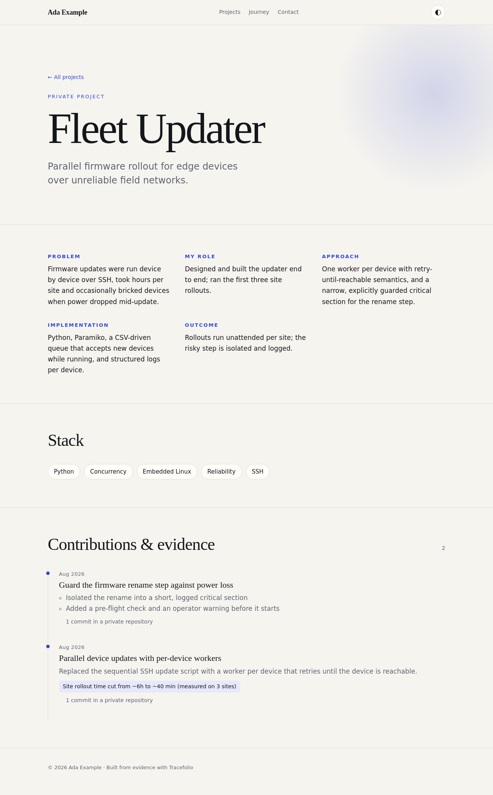

# Tracefolio

> **Your work, continuously understood.** A local-first, AI-provider-agnostic career memory that turns the real work you ship (with or without AI tools) into an evidence-backed resume and portfolio.


Developers ship more and more work with Claude Code, Codex, Cursor and friends, but that work rarely makes it into a CV. Tracefolio fixes the boring part:

- **Collects evidence:** it reads your git history and records *your* commits as draft career events. AI agents can record work too, through the same CLI.
- **Keeps you in control:** every record starts as a `draft`. Nothing reaches your resume until you approve it, and nothing reaches your public portfolio until you publish it.
- **Doesn't make things up:** metrics are only shown when you mark them as verified against evidence. Unverified numbers are never rendered.
- **Stays private by default:** your data lives in plain JSON/JSONL files on your machine. `.env` files, keys and secret-looking paths are filtered out, tokens in commit messages are redacted, and private repositories never expose commit hashes or links.
- **Generates the outputs:** an ATS-friendly Markdown resume, a print-ready HTML resume and a static, animated portfolio site with light and dark themes.

> **Status:** v0.1, the first milestone ("Local Career Profile MVP"). See [the roadmap](#roadmap) and the full plan in [TRACEFOLIO_PLAN.md](TRACEFOLIO_PLAN.md) (Turkish).

## Quick start

Requirements: Node.js 20+, git, and [pnpm](https://pnpm.io) 9.

```bash
git clone https://github.com/Kutluhankurt/tracefolio.git
cd tracefolio
pnpm install
pnpm build
cd packages/cli && npm link && cd ../..   # puts `tracefolio` on your PATH
```

Then build your first resume:

```bash
tracefolio init --headline "Backend engineer"        # creates ~/.tracefolio
tracefolio analyze ~/code/my-project --since "6 months ago"
tracefolio review                                      # approve, verify, publish or reject drafts
tracefolio build                                       # writes ~/.tracefolio/out/
tracefolio portfolio dev                               # preview at http://127.0.0.1:4321
```

If you don't want a global link, run `pnpm tracefolio <command>` from the repository root instead.

Want to look around first? Build the fictional demo profile:

```bash
pnpm tracefolio --home examples/demo build --out /tmp/tracefolio-demo
```

## How it works

```
AI tools / IDE agents ──► skills ──► tracefolio CLI ◄── git history (analyze)
                                           │
                                           ▼
                        ~/.tracefolio/profile/{profile.json, events.jsonl}
                                           │  you review: draft → reviewed / verified / published
                                           ▼
                  resume.md · resume.html · portfolio/ (static site + portfolio.json)
```

### Where your data lives

`tracefolio init` creates a **Tracefolio home** (default `~/.tracefolio`, initialized as its own git repo so your career history is versioned):

| Path | What it is |
| --- | --- |
| `profile/profile.json` | You: name, headline, links, experience, education, projects and project stories. Edit by hand. |
| `profile/events.jsonl` | Career events, one JSON object per line. Edit them through the CLI. |
| `tracefolio.config.json` | Analysis and privacy settings. |
| `out/` | Generated resume and portfolio (git-ignored). |

The home is resolved from `--home`, then `$TRACEFOLIO_HOME`, then the nearest parent folder containing `tracefolio.config.json`, then `~/.tracefolio`.

### Record statuses

| Status | Meaning | Resume | Portfolio |
| --- | --- | :-: | :-: |
| `draft` | Proposed by `analyze`, an AI agent, or you | – | – |
| `reviewed` | You approved it | ✓ | – |
| `verified` | Approved **and** backed by evidence you checked (requires evidence) | ✓ | – |
| `published` | You chose to show it publicly | ✓ | ✓ |
| `rejected` | Never shown; its commits are not re-imported | – | – |

Impact metrics have their own `verified` flag. A metric is displayed only when `impact.verified` is true, which in turn requires evidence. A record being approved does not verify its claims.

## Commands

| Command | Purpose |
| --- | --- |
| `tracefolio init` | Create the profile. Options: `--name`, `--email`, `--headline`, `--git-email` (repeatable), `--no-git`, `--force`. |
| `tracefolio analyze [repos...]` | Turn your new commits into drafts. Options: `--author`, `--since`, `--until`, `--group-by commit\|day\|week`, `--dry-run`. |
| `tracefolio update` | Record a draft event: `--title`, `--summary`, `--skills a,b`, `--project`, `--commit` + `--repo`, `--url`, `--file`, `--note`, `--metric`, `--source`, or `--json <file\|->`. |
| `tracefolio review` | Interactive review in a terminal. `--list [--filter status] [--json]` lists records; `review <id> --status reviewed --title … --summary … --skills … --metric … --impact-verified` edits one. |
| `tracefolio build` | `--format markdown\|html\|json\|portfolio\|all` (default `all`), `--out <dir>`. Prints ATS warnings. |
| `tracefolio portfolio build\|dev` | Build the static site, or build and serve it on localhost (`--port`). |
| `tracefolio project add <id>\|list` | Manage projects: `--name`, `--description`, `--url`, `--repository`, `--public`/`--private`, `--featured`. |
| `tracefolio integrate claude-code\|codex` | Install agent skills into a project (`--project <dir>`) or globally (`--user`). |
| `tracefolio status` / `validate` | Show counts per status, and validate all files against the schema. |

Which commits count as yours: `--author`, otherwise `identities.gitEmails` in `profile.json`, otherwise the repository's `git config user.email`. Commits already referenced by any record, including rejected ones, are never imported twice.

## AI integrations

Tracefolio's core does not depend on any AI provider. Agents talk to it through the same CLI you use, guided by three skills in [`skills/`](skills):

- **capture-work:** record the work done in the current session as a draft, with its commits as evidence.
- **update-career:** run `analyze` and walk the user through reviewing drafts.
- **generate-portfolio:** build the resume and portfolio, and help write project stories.

```bash
tracefolio integrate claude-code            # → ./.claude/skills/tracefolio-*/SKILL.md
tracefolio integrate claude-code --user     # → ~/.claude/skills/
tracefolio integrate codex                  # → ./AGENTS.md (a marked block, updated in place)
tracefolio integrate codex --user           # → ~/.codex/AGENTS.md
```

The skills tell agents to create drafts only, never invent metrics, keep secrets and customer details out, and ask before recording anything. Any other tool can integrate the same way by calling `tracefolio update --json -`.

**Limitations:** Tracefolio only sees what you or your agents hand it. It cannot read your conversations in ChatGPT or other web UIs, and different tools offer different integration hooks.

## Portfolio



`tracefolio portfolio build` produces a dependency-free static site: an editorial layout, light and dark themes (following the system setting, with a toggle), scroll reveals and a subtle parallax, all disabled under `prefers-reduced-motion` and all content readable without JavaScript. It also writes `portfolio.json` with exactly the data shown, so you can build your own theme on top.

Fill in project pages through `projects[].story` in `profile.json` (`problem`, `responsibility`, `approach`, `implementation`, `outcome`). Mark a project `--public` to show repository and commit links. Deploy the `out/portfolio` folder to any static host when you're ready; Tracefolio never publishes anything by itself.

## Privacy and security

- Everything stays local. Tracefolio makes no network calls.
- Sensitive paths (`.env*`, `*.pem`, `*.key`, `id_rsa*`, `*secret*`, `*credentials*`, `secrets/**`, and more) are dropped during analysis. Their names, stats and skills are never stored. Add your own patterns in `tracefolio.config.json` under `privacy.sensitivePatterns`.
- Token-like strings (GitHub/AWS/OpenAI/Slack keys, JWTs, `password=…`) are redacted from commit subjects and notes, and credentials are stripped from remote URLs.
- Commit messages are treated as evidence, not as proof of achievement. Every claim needs your review.
- Found a security issue? See [SECURITY.md](SECURITY.md).

## Development

```bash
pnpm install
pnpm build        # tsc project references
pnpm test         # vitest
```

The monorepo is split into `packages/core` (schemas, store, privacy), `git-adapter`, `generators` (resume and portfolio), `integrations` (agent installers) and `cli`. See [CONTRIBUTING.md](CONTRIBUTING.md).

## Roadmap

Done in v0.1: the CLI, the JSON/JSONL profile, git analysis with de-duplication and privacy filters, the review workflow, Markdown and HTML resumes, the static portfolio, Claude Code and Codex integrations, the demo profile, tests and CI.

Next:

- Direct PDF export (for now, print `resume.html` from a browser)
- Multiple resume templates and tailoring a resume to a job posting
- An MCP server and more agent adapters
- An Astro-based portfolio theme and a GitHub Actions deploy recipe
- Signed evidence bundles, multi-language output, and career models for non-developers

## License

[MIT](LICENSE) © Kutluhan Kurt
